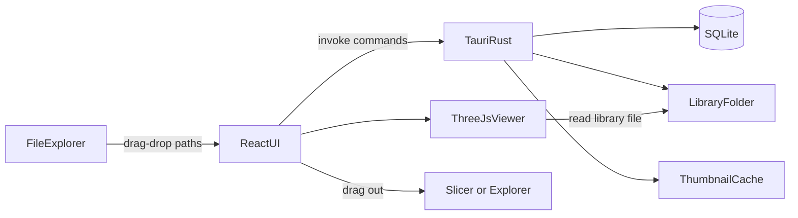

# 3D File Library (Windows)

Greenfield app in [d:\GitHub\3DFileManager](d:\GitHub\3DFileManager). Stack: **Tauri 2 + React + TypeScript + SQLite**. Import model: **copy into an app-managed library folder**.

**Primary goal:** a lightweight application that makes sorting and finding downloaded 3D-printer files easy. When a feature competes with that goal (size, startup time, complexity), the goal wins.

## Lightweight guardrails

- Tauri 2 (system WebView2), no Electron.
- **One 3D library only: three.js** (plus its own loaders: `STLLoader`, `3MFLoader`, `OBJLoader`). No other 3D or rendering engines.
- No heavy UI framework (no MUI/Ant/etc.). Plain React components styled with the theme tokens.
- Rust side: `rusqlite` (bundled), `zip`, `sevenz-rust`, `unrar` (use crates, do not shell out to external tools), `sha2`, `trash`, `walkdir`. Avoid adding crates beyond what a feature needs.
- Heavy work (hashing, archive extraction, thumbnail generation) runs off the UI thread with a progress indicator.

## What v1 will do

- Drag files, folders, or archives from Explorer onto the app, or use **Import folder...** / **Import archive...** from the menu. Supported files and their subfolders are copied into the library. After a successful import, a modal asks whether to **keep the originals** or **move them to the Recycle Bin**.
- **Theme**: default dark (Windows file-explorer look, per the reference screenshot); View menu switches Light / Dark. Colors live in CSS tokens so they are easy to retune. See *Theming (detailed)*.
- User-managed **folders** under the library root (real directories on disk). Seeded as *FDM Prints*, *Models*, *Wargaming Terrain*. Users can create, rename, nest, and delete folders in the UI. Files can be **moved** between folders (sidebar drag or inspector), which updates both the DB and the file on disk.
- Files keep their **original filenames on disk**, so the library is readable in Explorer and slicers show sensible object names.
- **Tags** (many-to-many), a **Creator** field (autocomplete, filter, sort), and a **Sort Name** field used as the primary alphabetical sort key (shown in the grid).
- Search by sort name, original filename, creator, tags, and notes via SQLite FTS.
- **Cached thumbnails** for every previewable file so the grid is fast and visual.
- **Drag out** of the grid into OrcaSlicer, Bambu Studio, ChiTuBox, or Explorer.
- **Rescan library** to resync the database with changes made in Explorer.
- **First launch** blocks the library UI until the user picks the library folder (no silent default path).
- Windows installer with a **Start menu shortcut**.

Out of v1: print-job tracking, G-code layer preview, background folder watching, cloud sync, Lychee (.lys) rendering, changing the library root.

## Architecture

- **Frontend** (`src/`): Vite + React. Folder-tree sidebar, search/filter bar, file grid, inspector (metadata + viewer).
- **Backend** (`src-tauri/`): Tauri commands for import (files, folders, archives), folder CRUD, move-file, metadata CRUD, search, rescan, thumbnail cache. SQLite via `rusqlite` with a simple migration on startup.
- **Library root (required first run)**: if no library path is stored, show a setup screen. The user must choose (or create) a folder via the native dialog. Do not assume `Documents/3DFileManager` or any other default. Persist the path in app settings; refuse import until it is set. After the root is chosen, create the three default subfolders on disk if they do not exist.
- **On-disk layout**: `{libraryRoot}/{folderPath}/{originalFileName}`. Names are sanitized for Windows (illegal characters replaced, reserved names like `CON` avoided, trailing dots/spaces trimmed). If a name already exists in the destination, append ` (2)`, ` (3)`, etc. before the extension. The DB stores both `original_name` (as imported) and `stored_relpath` (actual path on disk).
- **App data** (not in the library folder): `%APPDATA%\3D File Library\` holds `library.db`, `settings.json`, and `thumbs\`.

## Data model

- `folders`: id, parent_id (nullable = library root), name, sort_order, relpath
- `files`: id, original_name, sort_name, stored_relpath, ext, size_bytes, sha256, mtime, folder_id, creator, notes, source_archive (nullable), imported_at, thumb_status (`none` | `ok` | `unavailable`)
- `tags` / `file_tags`
- FTS5 virtual table over sort_name, original_name, creator, notes, and concatenated tags (`unicode61` tokenizer; underscores and dashes split words so `Throne_of_Baal` matches "throne"). Use prefix queries so partial words match as you type.

**Sort Name**: editable per file. On import, default to the original filename without extension, with underscores replaced by spaces. The grid sorts by `sort_name` (case-insensitive) by default, so a name like "The Watchtower" can be stored as "Watchtower". Creator and date are alternate sort options.

Duplicate imports (same sha256) are skipped and reported, not copied twice.

## Importing (drag-drop, folders, archives)

Tauri 2 `onDragDropEvent` gives OS paths. On drop or menu import:

1. Overlay shows "Import to {current library folder}".
2. Rust copies supported files (see list below). Dropped Explorer folders are walked recursively and their subfolder structure is recreated under the active folder.
3. **Archives** (`.zip`, `.rar`, `.7z`) are extracted to a temp folder, then imported like a dropped folder: a library folder named after the archive (without extension) is created under the active folder, and the archive's internal folder structure is preserved. Nested archives inside an archive are imported one level deep only. Unsupported files inside archives are skipped and counted in the import summary. Password-protected or corrupt archives are reported and skipped. Files record `source_archive` for reference. The temp folder is always deleted afterward.
4. New rows go into the target folders; `sort_name` defaults from the filename; creator/tags/sort name can be edited in the inspector (and in a small post-import panel for bulk imports).
5. After copies succeed, show one modal for the whole batch: "Keep the originals, or move them to the Recycle Bin?" Actions: **Keep originals** (default focus) / **Move to Recycle Bin**. For archive imports the original is the archive file itself.
6. Recycle only originals that imported fully. Never recycle skipped duplicates, failed copies, or archives with any failed entry. Use the `trash` crate (Windows Recycle Bin), never permanent delete. If recycling fails (locked file, permissions), report which paths remain and leave the library copies intact.

Capabilities must allow `fs` read of drop sources, create/rename/delete directories under the library path, write/move files there, and recycling confirmed original paths.

## Library folders and moving files

Organization is a real folder tree under the managed root.

- **Create**: New folder (or nested folder under the selected one). Name must be unique among siblings; reject Windows-illegal characters.
- **Rename**: Renames the directory on disk and updates child `relpath` / `stored_relpath` values.
- **Delete folder**: v1 blocks delete when the folder is not empty (no files, no child folders).
- **Move file**: Drag a grid item onto a sidebar folder, or pick a destination in the inspector. Rust renames the file into the destination folder (applying the ` (2)` suffix rule on collision); DB `folder_id` and `stored_relpath` update.
- **Delete file** (in app): moves the library copy to the Recycle Bin and removes the DB row and cached thumbnail.

## Rescan library

Menu command **File > Rescan library** (also offered if the app detects a missing file). It walks the library root and reconciles with the DB:

- Files in the DB but missing on disk: try to find them by sha256 elsewhere in the library (moved in Explorer) and update the path; otherwise mark missing and list them so the user can remove the entries.
- Folders on disk but not in the DB: add them to the folder tree.
- Supported files on disk but not in the DB: add them (hash, default sort name, queue a thumbnail).
- Folders renamed in Explorer are handled by the above (new folder added, files found by hash).
- Runs in the background with progress; never deletes anything on disk.

## Supported file types and previews

Import for:

- Mesh / FDM: `.stl`, `.3mf`, `.obj`, `.gcode`, `.bgcode`
- Resin slice / project: `.ctb`, `.chitubox`, `.ags`, `.lys`
- Images: `.png`, `.jpg`, `.jpeg`
- Archives (unpacked on import, not stored): `.zip`, `.rar`, `.7z`

Preview policy: show something whenever it is cheap to get; otherwise "Preview unavailable" (the file still catalogs normally).

- **`.stl` / `.obj`**: Three.js orbit viewer in the inspector; rendered still for the thumbnail cache.
- **`.3mf`**: thumbnail first tries the embedded image (`Metadata/thumbnail.png`, `Metadata/plate_1.png`, or the path in the package relationships). If none, render a still. Inspector uses the Three.js `3MFLoader`.
- **`.lys` (Lychee)**: **no rendering**. Import and catalog only; if the archive happens to contain a PNG/JPEG, use it as the thumbnail, otherwise show the type icon.
- **`.ctb`**: extract the embedded large preview (RGB565 RLE) in Rust and show it as a 2D image. Encrypted CTB v4+ may fail; then unavailable. No layer-stack rendering.
- **`.chitubox` / `.ags`**: if the file is a ZIP containing a PNG/JPEG, use that image; otherwise unavailable. No 3D rendering, no format reverse-engineering.
- **`.png` / `.jpg` / `.jpeg`**: the image itself.
- **`.gcode` / `.bgcode`**: use an embedded thumbnail if present (PrusaSlicer/Orca/Bambu write base64 PNG thumbnails in comments; bgcode has a thumbnail block); otherwise type icon.

Inspector: mesh files get the Three.js canvas; everything else gets an image pane in the same slot.

## Thumbnail cache

- Location: `%APPDATA%\3D File Library\thumbs\{sha256}.png`, one PNG at 256px (the Extra large size; smaller grid sizes scale it down). Keyed by hash so moves and renames never invalidate it.
- Generated in the background after import (and during rescan), never blocking the import itself. `thumb_status` tracks result so failures are not retried every launch.
- Sources in priority order: embedded image (3MF, G-code, CTB, image files, images inside .lys/.chitubox/.ags) extracted in Rust; otherwise for `.stl` / `.obj` / `.3mf` without an image, the frontend renders a still with an offscreen Three.js renderer (fit to view, neutral gray, isometric angle) and sends the PNG to Rust to save.
- Render queue processes one mesh at a time and skips meshes above a size limit (e.g. 150 MB) to keep memory in check; those show the type icon.
- Grid only reads cached PNGs; it never loads meshes.
- Deleting a file deletes its thumbnail if no other file shares the hash. A "Clear thumbnail cache" setting regenerates them.

## Drag out to slicers

- Use `tauri-plugin-drag` (CrabNebula) to start a native OS file drag from a grid tile (or multi-selection), passing the absolute paths of the library files and the cached thumbnail as the drag image.
- Because files keep their original names, OrcaSlicer, Bambu Studio, and ChiTuBox show proper object names. These slicers accept files dropped from Explorer, so they accept these drags the same way.
- Dragging out is always a **copy reference** to the library file (the slicer opens it in place); it never moves or deletes the library copy.
- Dragging a tile onto a sidebar folder inside the app is still an internal move; the drag-out starts only when the pointer leaves the window (or use a modifier key; pick whichever the plugin supports cleanly).
- Fallback if drag-out proves unreliable: inspector buttons **Open in default app** and **Show in Explorer**.

## Grid preview sizes (Explorer-style)

A View control (toolbar or View menu) switches the file grid among three icon sizes:

- **Medium**: about 96px tiles
- **Large**: about 128px tiles
- **Extra large**: about 256px tiles

Persist the choice in settings. Each tile shows the cached thumbnail when available, otherwise a type icon, plus the sort name underneath. Changing size only resizes the grid; it does not reload files. The inspector preview pane is sized independently.

## UI layout

- **Left**: folder tree under the library root + New folder / Rename / Delete. Click a folder to show its files. "All files" view at the top.
- **First-run overlay**: "Choose where this app should store its library copies" + folder picker; Continue stays disabled until a folder is selected.
- **Top**: search, creator filter, tag filter, sort (sort name / creator / date), View: Medium / Large / Extra large.
- **Center**: icon grid at the selected size (thumbnail + sort name; creator/tags as secondary text or tooltip). Tiles are draggable to sidebar folders and out to slicers.
- **Right**: inspector with sort name, creator, tags, folder (move), notes, original filename (read-only), source archive (read-only), Open in default app, Show in Explorer, Delete (to Recycle Bin).
- **Viewer**: Three.js canvas (orbit, fit-to-view, gray material) for mesh files; static image otherwise. Large files load asynchronously; failures show "Preview unavailable".

Serve library bytes through Tauri's asset protocol (`convertFileSrc`) scoped to the library root. Do not rely on raw `file://` in the webview.

## Windows installer and Start menu shortcut

- Build the installer with `tauri build` using the **NSIS** bundler (`bundle.targets: ["nsis"]` in `src-tauri/tauri.conf.json`); MSI is optional later.
- Set `productName` to **3D File Library** and a stable `identifier` (e.g. `com.jasonmcadams.3dfilelibrary`); set `bundle.icon` so the shortcut has the app icon.
- The installer must create a **Start menu shortcut** named **3D File Library** that launches the app. Tauri's NSIS installer creates one by default; keep that enabled and set `bundle.windows.nsis.startMenuFolder` only if a subfolder is wanted (default: no subfolder).
- **No desktop shortcut** by default.
- Uninstall removes the Start menu shortcut and app files but **never** deletes the user's library folder or its files.

## Implementation order

1. Scaffold Tauri 2 + Vite React TS; Windows `tauri dev` / `tauri build` (NSIS installer with Start menu shortcut). Theme tokens and ThemeProvider from day one.
2. SQLite + migrations + required first-run library-folder picker (no default path).
3. Folder tree CRUD on disk + DB, seed three default folders, move-file command, filename sanitizing and collision suffix.
4. Import of files and folders into the active folder + drag-drop UI + keep-or-recycle-originals modal.
5. Archive import (zip, then 7z, then rar).
6. File grid with Medium / Large / Extra large sizes, search, Sort Name / creator / tag filter and sort, inspector edits including folder move.
7. Thumbnail cache: embedded-image extraction (3MF, G-code, CTB, images), then offscreen Three.js stills for STL/OBJ/3MF.
8. Inspector Three.js viewer for STL / 3MF / OBJ.
9. Drag out to slicers and Explorer.
10. Rescan library.
11. Polish: empty states, duplicate reporting, `.gitignore` for `node_modules` / `target`.

## Verification (Windows)

- Install: Start menu has "3D File Library", no desktop shortcut; uninstall removes the shortcut and leaves the library folder untouched.
- First launch requires picking a library folder; default subfolders exist on disk.
- Files on disk keep their original names; importing a second file with the same name creates `Name (2).stl`.
- Drop mixed `.stl` / `.3mf` / `.obj` / `.ctb` / `.lys` / `.chitubox` / `.ags` / `.gcode` / `.png` / `.jpg`; drop a folder tree; import a `.zip`, `.7z`, and `.rar` and confirm the folder structure is preserved.
- Choose Move to Recycle Bin and confirm originals are in the Recycle Bin and restorable.
- Thumbnails: Bambu `.3mf` shows its embedded plate image; plain STL shows a rendered still; restart and confirm thumbnails load from cache without re-rendering. `.lys` shows an icon (or embedded image), never a 3D render.
- Drag an STL and a 3MF from the grid into OrcaSlicer, Bambu Studio, and ChiTuBox; the object names match the filenames.
- Move a file in Explorer and rename a folder in Explorer, run Rescan, and confirm the app finds them with tags and notes intact.
- Set Sort Name / tags / creator; search partial words ("thro" finds "Throne_of_Baal").
- Switch Medium / Large / Extra large; switch Dark / Light and restart.
- Delete in-app sends the library copy to the Recycle Bin.

## Theming (detailed)

Goal: the UI matches the Files-style Windows explorer in the reference screenshot. Dark is the default; the View menu offers **Theme > Dark / Light**. Every color lives in one file so the palette can be retuned without touching components.

### Reference mockups

These images live next to this plan and show the intended look of each theme. Colors in them match the token tables below; layout is illustrative (preview tiles and file names are placeholders).

- Dark (default): [Dark_themed_example.png](Dark_themed_example.png)
- Light: [Light_themed_example.png](Light_themed_example.png)

If a mockup and the token tables disagree, the token tables win.
### Files

- `src/theme/tokens.css` is the single source of truth. It defines semantic CSS custom properties under `:root[data-theme="dark"]` and `:root[data-theme="light"]`. No component may use a raw hex value; components only use `var(--token)`.
- `src/theme/ThemeProvider.tsx` holds the current theme in React context, sets `document.documentElement.dataset.theme`, and exposes `useTheme()` returning `{ theme, setTheme }`.
- `src/theme/themes.ts` exports `type ThemeName = "dark" | "light"` and `DEFAULT_THEME = "dark"`.
- Persistence: store `theme` in the same app settings as library path and grid size. On startup, apply the saved theme before first paint (set `data-theme` in `index.html` from a small inline script or from Rust-provided settings) to avoid a light flash.

### Dark palette (sampled from the reference screenshot)

| Token | Value | Used for |
|---|---|---|
| `--color-bg-app` | `#191b1c` | Main file-grid area, toolbar, column header, status bar |
| `--color-bg-sidebar` | `#1f2223` | Left folder tree, title bar / tab strip, inspector panel |
| `--color-bg-input` | `#34383a` | Search, filter, and inspector input fields (lighter than the active tab) |
| `--color-bg-tab-active` | `#2b2e30` | Selected tab (lighter than the strip) |
| `--color-bg-tab-inactive` | `#141617` | Inactive tabs (darker than the strip) |
| `--color-text-tab-inactive` | `#8a8c8e` | Inactive tab labels |
| `--color-bg-hover` | `#1d1f21` | Row / tile hover, alternate surfaces |
| `--color-bg-selected` | `#202324` | Selected row or tile fill |
| `--color-bg-sunken` | `#121212` | Deepest surfaces, progress-bar tracks |
| `--color-border` | `#343a3b` | Input outlines, selected-item outline, panel edges |
| `--color-divider` | `#3f4143` | Sidebar / column separators |
| `--color-text` | `#dddee0` | Primary text |
| `--color-text-muted` | `#7b7c7e` | Secondary text (type, date, size columns, section labels) |
| `--color-text-subtle` | `#6b7078` | Placeholder text, disabled icons |
| `--color-accent` | `#0079a6` | Accent: drive-usage bars, focus rings, primary buttons, 3D-file icons, active toggles |
| `--color-accent-contrast` | `#ffffff` | Text on accent backgrounds |

Values are sampled from the screenshot and may be adjusted by eye during implementation; change them only in `tokens.css`.

### Light palette (starting point, tune later)

| Token | Value |
|---|---|
| `--color-bg-app` | `#ffffff` |
| `--color-bg-sidebar` | `#f3f3f3` |
| `--color-bg-input` | `#ffffff` |
| `--color-bg-tab-active` | `#ffffff` |
| `--color-bg-tab-inactive` | `#dcdcdc` |
| `--color-text-tab-inactive` | `#3c4043` |
| `--color-bg-hover` | `#ebebeb` |
| `--color-bg-selected` | `#dcebf2` |
| `--color-bg-sunken` | `#e5e5e5` |
| `--color-border` | `#d0d0d0` |
| `--color-divider` | `#e0e0e0` |
| `--color-text` | `#1b1b1b` |
| `--color-text-muted` | `#5f6368` |
| `--color-text-subtle` | `#8a8d91` |
| `--color-accent` | `#0079a6` |
| `--color-accent-contrast` | `#ffffff` |

### Non-color tokens (shared by both themes)

- `--font-ui: "Segoe UI Variable", "Segoe UI", system-ui, sans-serif;` at `--font-size-ui: 13px`.
- `--radius-sm: 4px; --radius-md: 6px;` (tabs, inputs, selected row outline).
- `--row-height: 20px` for list rows; spacing scale `--space-1..4` = 4/8/12/16px.
- 3D viewer: `--viewer-bg` (dark `#191b1c`, light `#f3f3f3`) and `--viewer-mesh` (gray `#9a9da0` in both); the Three.js scene reads these from `getComputedStyle` and re-reads on theme change.

### Look and feel to match

- Title/tab strip and sidebar share `--color-bg-sidebar`; the active tab blends into the content area using `--color-bg-app`.
- Sidebar section headers (Recents, Bookmarks, Storage, Places) use `--color-text-muted` with a chevron at the right.
- Folder grid/list has no visible row borders; hover uses `--color-bg-hover`, selection uses `--color-bg-selected` with a 1px `--color-border` outline and `--radius-sm`.
- Column header and status bar sit on `--color-bg-app` with muted text; status bar holds the filter box (left) and Medium / Large / Extra large view toggle (right).
- Scrollbars: thin, thumb `--color-divider`, track transparent.
- Focus rings: 1px `--color-accent`.

### Menu and behavior

- View menu gets **Theme** with radio items **Dark** (default, checked on first run) and **Light**. Selecting one updates context, `data-theme`, and settings immediately; no restart.
- Use the same native Tauri menu as the grid-size options so both live under View.

### Acceptance

- Fresh install opens in dark theme matching the screenshot.
- Switching to Light and restarting keeps Light.
- `rg "#[0-9a-fA-F]{3,6}" src --glob "!src/theme/**"` returns nothing (all colors go through tokens).
- Changing one value in `tokens.css` updates every place that color is used.
