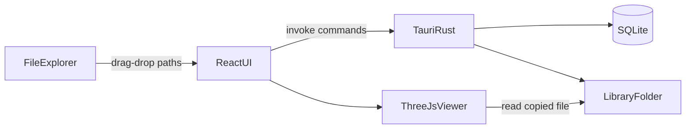
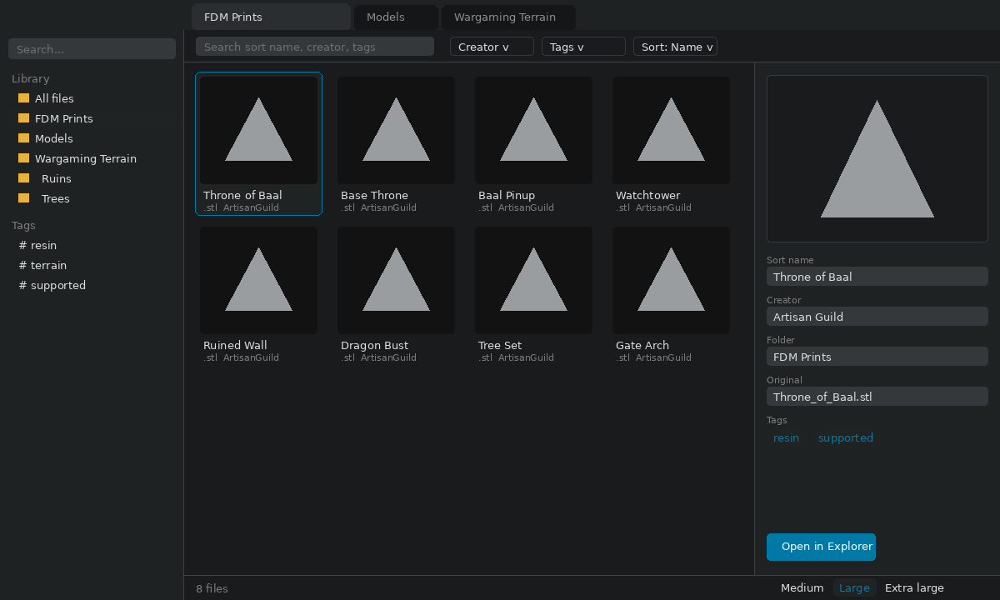
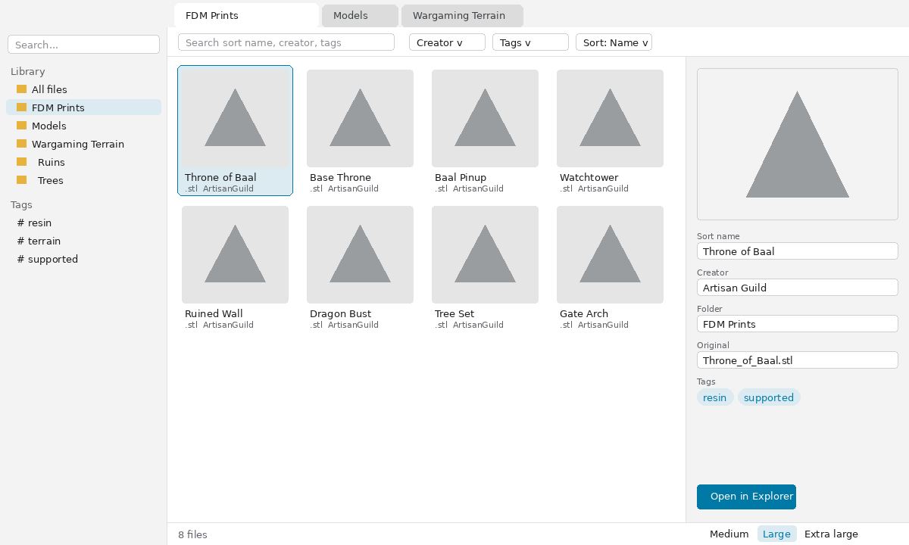

---
name: 3D File Library
overview: Build a Windows desktop 3D-print file library with Tauri 2, React, TypeScript, and SQLite. First launch requires picking the library folder. Users import files or entire folder trees, organize with nested folders/tags/creator/Sort Name, and preview meshes or images. UI is token-based theming (default dark, matching Windows Explorer; switchable to light). Grid uses Medium / Large / Extra large preview sizes.
todos:
  - id: scaffold
    content: Scaffold Tauri 2 + Vite React TypeScript app and Windows build scripts
    status: pending
  - id: db-library
    content: SQLite schema/migrations (including sort_name and folder tree), required first-run library-folder picker, create default library folders on disk
    status: pending
  - id: import-dnd
    content: Copy-on-drop plus mass Import folder (preserve subfolder tree), hash dedupe, keep-or-delete-originals prompt
    status: pending
  - id: browse-meta
    content: Folder tree UI, move files, file grid with Medium/Large/Extra large sizes, token-based dark/light theme (default dark), FTS search, inspector edits
    status: pending
  - id: preview-3d
    content: Previews _ 3D for .stl/.3mf/.lys; images for .png/.jpg/.jpeg and CTB thumbs; best-effort .chitubox/.ags
    status: pending
  - id: verify-win
    content: Manual Windows verification of import, organize, search, preview, and delete
    status: pending
isProject: false
---

# 3D File Library (Windows)

Greenfield app in [d:\GitHub\3DFileManager](d:\GitHub\3DFileManager). Stack: **Tauri 2 + React + TypeScript + SQLite**. Import model: **copy into an app-managed library folder**.

## What v1 will do

- Drag files (or folders) from Explorer onto the app, or **Import folder_** from the menu, to copy a whole tree of supported files and subfolders. After a successful copy, a modal asks whether to **keep the original** or **delete the original**.
- **Theme**: default dark (Windows Explorer“like, per the attached screenshot); View menu switches Light / Dark. Colors live in CSS tokens so they are easy to retune.
- User-managed **folders** under the library root (real directories on disk). Seeded as *FDM Prints*, *Models*, *Wargaming Terrain*. Users can create, rename, nest, and delete folders in the UI. Files can be **moved** between folders (sidebar drag or inspector), which updates both the DB path and the file on disk.
- **Tags** (many-to-many), a **Creator** field (autocomplete, filter, sort), and a **Sort Name** field used as the primary alphabetical sort key (and shown in the grid).
- Search by sort name, original filename, creator, tags, and notes via SQLite FTS.
- **First launch** blocks the library UI until the user picks the app-managed library folder (no silent default path).
- Detail view with previews where the format allows (see Supported file types). Other print files (e.g. `.gcode`, `.obj`) can be imported and listed; `.obj` can reuse the 3D viewer if cheap, otherwise listed only.
- File-grid **preview size** like Explorer: **Medium**, **Large**, **Extra large** (persisted).

Out of v1: print-job tracking, G-code layer preview, folder watching, cloud sync.

## Architecture

- **Frontend** (`src/`): Vite + React. Folder-tree sidebar, search/filter bar, file grid, inspector (metadata + viewer).
- **Backend** (`src-tauri/`): Tauri commands for import, copy, folder CRUD, move-file, metadata CRUD, search. SQLite with `rusqlite` (or `sqlx`) and a simple migration on startup.
- **Library root (required first-run)**: on first startup, if no library path is stored, show a dedicated setup screen. The user must choose (or create) a folder via the native dialog. Do not assume `Documents/3DFileManager` or any other default. Persist the path in app settings; refuse import until it is set. Changing the library root later is out of v1. After the root is chosen, create the three default subfolders on disk if they do not exist.
- **On-disk layout**: `{libraryRoot}/{folderPath}/{uuid}{ext}`. Folder names are user-visible (sanitized for Windows). Original filename lives in the DB so disk names never collide. Moving a file relocates that copy under the destination folder and updates `stored_relpath` / `folder_id`.

## Data model

- `folders`: id, parent_id (nullable = library root), name, sort_order, relpath
- `files`: id, original_name, sort_name, stored_relpath, ext, size_bytes, sha256, folder_id, creator, notes, imported_at
- `tags` / `file_tags`
- FTS5 virtual table over sort_name, original_name, creator, notes, and concatenated tags

**Sort Name**: editable per file. On import, default to the original filename without extension. The file grid sorts by `sort_name` (case-insensitive) by default so names like œThe Watchtower can be stored as œWatchtower. Creator and date remain alternate sort options.

Duplicate imports (same sha256) are skipped and reported, not copied twice.

## Drag-and-drop import

Tauri 2 `onDragDropEvent` gives OS paths. On drop:

1. Overlay shows œImport to {current library folder}.
2. Rust copies supported files (see list below); dropped Explorer folders are walked recursively (this is the *source* walk, not library-folder creation).
3. New rows go into the **active library folder**; `sort_name` defaults from the filename; creator/tags/sort name can be edited immediately in the inspector (and in a small post-import toast/panel for bulk drops).
4. After copies succeed, show a modal: œKeep the original file(s) in place, or delete them? Primary actions: **Keep original** / **Delete original**. Default focus is Keep. One prompt per drop (covers the whole batch, including folder walks), not one dialog per file.
5. Delete originals only for files that copied successfully. Never delete skipped duplicates or failed copies. If delete fails (locked file, permissions), report which paths remain and leave the library copies intact.

Capabilities must allow `fs` read of drop sources, create/rename/delete directories under the library path, write/move files there, and delete of confirmed original paths.

## Library folders and moving files

These replace the earlier œvirtual sections idea: organization is a real folder tree under the managed root.

- **Create**: New folder (or nested folder under the selected one). Name must be unique among siblings; reject Windows-illegal characters.
- **Rename**: Renames the directory on disk and updates child `relpath` / `stored_relpath` values.
- **Delete folder**: Only if empty (no files, no child folders), or after the user confirms moving/deleting contents _ v1: block delete when not empty.
- **Move file**: Drag a grid item onto a sidebar folder, or pick a destination in the inspector. Rust `rename`s the copied file into the destination folder; DB `folder_id` and `stored_relpath` update. Fail if destination would collide (uuid names make this rare).
- Folders created outside the app in Explorer are not auto-indexed in v1.

## Supported file types and previews

Import (copy into the library) for:

- Mesh / FDM: `.stl`, `.3mf`, `.obj`, `.gcode`, `.bgcode`
- Resin slice / project: `.ctb`, `.chitubox`, `.ags`, `.lys`
- Images: `.png`, `.jpg`, `.jpeg`

Preview policy _ show something whenever we can extract it; otherwise œPreview unavailable (file still catalogs normally).

- **`.stl` / `.3mf`**: orbit 3D mesh (existing plan). `.3mf` uses the first mesh in `3D/3dmodel.model`.
- **`.lys` (Lychee scene)**: usually a compressed archive with JSON + binary mesh. v1 tries to unpack and load the largest geometry blob into Three.js (same orbit viewer). If the layout is a newer/legacy variant we cannot parse, fall back to any PNG/JPEG inside the archive; else unavailable.
- **`.ctb` (ChiTu sliced print)**: layer bitmaps, not a mesh. Older files (and many newer ones) embed two printer thumbnails (RGB565 RLE). Extract the large preview in Rust and show it as a **2D image** in the inspector. Encrypted CTB v4+ may fail; then unavailable _ do not attempt full layer-stack 3D in v1.
- **`.chitubox` (ChiTuBox project)**: proprietary project (model + supports), not a public mesh spec. v1: if the file is a ZIP (or contains `.stl`/`.obj`/images), preview that; otherwise unavailable. No full reverse-engineer of the project format in v1.
- **`.ags`**: not a well-documented resin/slicer format publicly. Still **import**. Preview: sniff ZIP/STL/OBJ/PNG/JPEG; otherwise unavailable.
- **`.png` / `.jpg` / `.jpeg`**: show the image itself in the grid tile and in the inspector (letterboxed, no 3D). Same catalog fields as other files (sort name, creator, tags, folder).

Inspector viewer: mesh files get the Three.js canvas; images and slice thumbnails get an image pane; both share the same inspector slot.

## Grid preview sizes (Explorer-style)

A View control (toolbar or View menu) switches the file grid among three icon sizes, matching the Explorer names:

- **Medium** _ ~96px tiles
- **Large** _ ~128px tiles
- **Extra large** _ ~256px tiles

Persist the choice in app settings (last used). Each tile shows the type™s preview when available (PNG/JPEG, extracted CTB thumb, later a still of a 3D file if we already have one); otherwise a type icon at that size plus sort name under the tile. Changing size only resizes the grid; it does not reload files. Inspector 3D/image pane stays independently sized (fills the inspector column).

## UI layout

- **Left**: folder tree under the library root + New folder / Rename / Delete. Click a folder to show its files. Optional œAll files view at the top.
- **First-run overlay**: œChoose where this app should store its library copies + folder picker; Continue stays disabled until a folder is selected.
- **Top**: search, creator filter, tag filter, sort (sort name / creator / date), **View: Medium / Large / Extra large**
- **Center**: icon grid of files at the selected preview size (thumbnail + sort name; creator/tags as secondary text or tooltip)
- **Right**: inspector _ sort name, creator, tags, folder (move), notes, original filename (read-only), open-in-Explorer, delete (removes DB row + copied file)
- **Viewer**: Three.js canvas (orbit, fit-to-view, gray material) for mesh previews; static image for CTB (and other) thumbnails. Large files load asynchronously; failures show œpreview unavailable.

Serve library bytes through a Tauri-allowed path (`convertFileSrc` or a command that returns `Vec<u8>` / a blob URL). Do not rely on raw `file://` in the webview.

## Windows installer and Start menu shortcut

- Build the installer with `tauri build` using the **NSIS** bundler (`bundle.targets: ["nsis"]` in `src-tauri/tauri.conf.json`); MSI is optional later.
- Set `productName` to **3D File Library** and a stable `identifier` (e.g. `com.jasonmcadams.3dfilelibrary`); set `bundle.icon` so the shortcut has the app icon.
- The installer must create a **Start menu shortcut** named **3D File Library** that launches the app. Tauri's NSIS installer creates one by default under the Start menu programs folder; keep that enabled and set `bundle.windows.nsis.startMenuFolder` only if a subfolder is wanted (default: no subfolder).
- Optional: desktop shortcut is **not** created by default.
- Uninstall removes the Start menu shortcut and app files but **never** deletes the user's library folder or its copied files.

Verify: run the installer on Windows, open Start, search "3D File Library", launch it from the shortcut, then uninstall and confirm the shortcut is gone and the library folder is untouched.

## Implementation order

1. Scaffold Tauri 2 + Vite React TS; Windows `tauri dev` / `tauri build` (NSIS installer with Start menu shortcut).
2. SQLite + migrations + required first-run library-folder picker (no default path).
3. Folder tree CRUD on disk + DB, seed three default folders, move-file command.
4. Import/copy command into the active folder + Explorer drag-drop UI + keep-or-delete-originals modal.
5. File grid with Medium/Large/Extra large preview sizes, search, Sort Name / creator / tag filter/sort, inspector edits including folder move.
6. Previews: Three.js for STL/3MF/LYS; native PNG/JPEG; CTB thumbnail decode; ZIP/image sniff for .chitubox and .ags.
7. Polish: empty states, duplicate handling, open containing folder, `.gitignore` for `node_modules` / `target` / library data.

Verify on Windows: first launch requires picking a library folder before import works; default subfolders exist on disk; create a nested folder; drop mixed `.stl` / `.3mf` / `.ctb` / `.lys` / `.chitubox` / `.ags` / `.png` / `.jpg`; Keep/Delete originals behaves as specified; move a file to another folder and confirm it moved on disk; set Sort Name / tags / creator; search; switch Medium / Large / Extra large and confirm tiles resize; PNG/JPEG show as images; STL/3MF orbit; CTB shows a thumbnail when the file embeds one; deleting in-app removes the library copy.

## Theming (detailed)

Goal: the UI matches the Files-style Windows explorer in the reference screenshot. Dark is the default; the View menu offers **Theme > Dark / Light**. Every color lives in one file so the palette can be retuned without touching components.

### Reference mockups

These images live next to this plan and show the intended look of each theme. Colors in them match the token tables below; layout is illustrative (preview tiles and file names are placeholders).

- Dark (default): [Dark_themed_example.png](Dark_themed_example.png)
- Light: [Light_themed_example.png](Light_themed_example.png)

If a mockup and the token tables disagree, the token tables win.
### Files

- `src/theme/tokens.css` is the single source of truth. It defines semantic CSS custom properties under `:root[data-theme="dark"]` and `:root[data-theme="light"]`. No component may use a raw hex value; components only use `var(--token)`.
- `src/theme/ThemeProvider.tsx` holds the current theme in React context, sets `document.documentElement.dataset.theme`, and exposes `useTheme()` returning `{ theme, setTheme }`.
- `src/theme/themes.ts` exports `type ThemeName = "dark" | "light"` and `DEFAULT_THEME = "dark"`.
- Persistence: store `theme` in the same app settings as library path and grid size. On startup, apply the saved theme before first paint (set `data-theme` in `index.html` from a small inline script or from Rust-provided settings) to avoid a light flash.

### Dark palette (sampled from the reference screenshot)

| Token | Value | Used for |
|---|---|---|
| `--color-bg-app` | `#191b1c` | Main file-grid area, toolbar, column header, status bar |
| `--color-bg-sidebar` | `#1f2223` | Left folder tree, title bar / tab strip, inspector panel |
| `--color-bg-input` | `#34383a` | Search, filter, and inspector input fields (lighter than the active tab) |
| `--color-bg-tab-active` | `#2b2e30` | Selected tab (lighter than the strip) |
| `--color-bg-tab-inactive` | `#141617` | Inactive tabs (darker than the strip) |
| `--color-text-tab-inactive` | `#8a8c8e` | Inactive tab labels |
| `--color-bg-hover` | `#1d1f21` | Row / tile hover, alternate surfaces |
| `--color-bg-selected` | `#202324` | Selected row or tile fill |
| `--color-bg-sunken` | `#121212` | Deepest surfaces, progress-bar tracks |
| `--color-border` | `#343a3b` | Input outlines, selected-item outline, panel edges |
| `--color-divider` | `#3f4143` | Sidebar / column separators |
| `--color-text` | `#dddee0` | Primary text |
| `--color-text-muted` | `#7b7c7e` | Secondary text (type, date, size columns, section labels) |
| `--color-text-subtle` | `#6b7078` | Placeholder text, disabled icons |
| `--color-accent` | `#0079a6` | Accent: drive-usage bars, focus rings, primary buttons, 3D-file icons, active toggles |
| `--color-accent-contrast` | `#ffffff` | Text on accent backgrounds |

Values are sampled from the screenshot and may be adjusted by eye during implementation; change them only in `tokens.css`.

### Light palette (starting point, tune later)

| Token | Value |
|---|---|
| `--color-bg-app` | `#ffffff` |
| `--color-bg-sidebar` | `#f3f3f3` |
| `--color-bg-input` | `#ffffff` |
| `--color-bg-tab-inactive` | `#dcdcdc` |
| `--color-text-tab-inactive` | `#3c4043` |
| `--color-bg-hover` | `#ebebeb` |
| `--color-bg-selected` | `#dcebf2` |
| `--color-bg-sunken` | `#e5e5e5` |
| `--color-border` | `#d0d0d0` |
| `--color-divider` | `#e0e0e0` |
| `--color-text` | `#1b1b1b` |
| `--color-text-muted` | `#5f6368` |
| `--color-text-subtle` | `#8a8d91` |
| `--color-accent` | `#0079a6` |
| `--color-accent-contrast` | `#ffffff` |

### Non-color tokens (shared by both themes)

- `--font-ui: "Segoe UI Variable", "Segoe UI", system-ui, sans-serif;` at `--font-size-ui: 13px`.
- `--radius-sm: 4px; --radius-md: 6px;` (tabs, inputs, selected row outline).
- `--row-height: 20px` for list rows; spacing scale `--space-1..4` = 4/8/12/16px.
- 3D viewer: `--viewer-bg` (dark `#191b1c`, light `#f3f3f3`) and `--viewer-mesh` (gray `#9a9da0` in both); the Three.js scene reads these from `getComputedStyle` and re-reads on theme change.

### Look and feel to match

- Title/tab strip and sidebar share `--color-bg-sidebar`; the active tab blends into the content area using `--color-bg-app`.
- Sidebar section headers (Recents, Bookmarks, Storage, Places) use `--color-text-muted` with a chevron at the right.
- Folder grid/list has no visible row borders; hover uses `--color-bg-hover`, selection uses `--color-bg-selected` with a 1px `--color-border` outline and `--radius-sm`.
- Column header and status bar sit on `--color-bg-app` with muted text; status bar holds the filter box (left) and Medium / Large / Extra large view toggle (right).
- Scrollbars: thin, thumb `--color-divider`, track transparent.
- Focus rings: 1px `--color-accent`.

### Menu and behavior

- View menu gets **Theme** with radio items **Dark** (default, checked on first run) and **Light**. Selecting one updates context, `data-theme`, and settings immediately; no restart.
- Use the same native Tauri menu as the grid-size options so both live under View.

### Acceptance

- Fresh install opens in dark theme matching the screenshot.
- Switching to Light and restarting keeps Light.
- `rg "#[0-9a-fA-F]{3,6}" src --glob "!src/theme/**"` returns nothing (all colors go through tokens).
- Changing one value in `tokens.css` updates every place that color is used.
