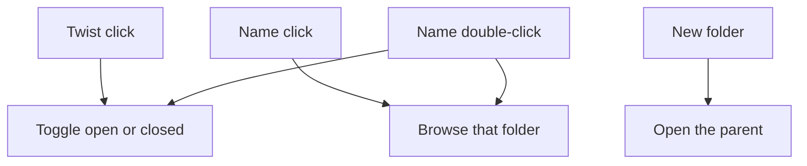

# Explorer-style folder tree and lazy preview icons

The left nav in [`src/components/Sidebar.tsx`](src/components/Sidebar.tsx) already walks `FolderRow.parentId`, but `renderLevel` always prints every child. Clicking a row only changes the browse selection. No backend change is needed: the full folder list is already loaded.

The file grid stays as it is. Selecting a folder still shows that folder’s files only.

## Interaction

Match the Explorer navigation pane:

- A folder with child folders gets a twist button. Folders with no children get a blank spacer so names still line up.
- Clicking the twist only opens or closes that folder. It does not change which folder is selected.
- Clicking the name still browses that folder, same as today.
- Double-clicking the name browses it and toggles it open or closed when it has children.
- The library root row works the same way, so the whole tree can be closed.
- **All files** stays a single flat item with no twist.
- Left arrow closes the focused folder (or moves to its parent if it is already closed). Right arrow opens it (or moves to the first child if it is already open). Up and down move between visible rows. Keys apply only while a folder row is focused.

Default open state for the session: the library root is open, and every nested folder starts closed. Expanded ids live in component state and reset when the app restarts.

When the selection moves to a nested folder, open its ancestors once so the highlight is visible. Collapsing a parent afterward stays collapsed, even if the selected folder is hidden inside it.

After **New folder** succeeds, open the parent (the current browse folder, or the library root) so the new folder is visible. [`src/App.tsx`](src/App.tsx) can pass a small `{ key, nonce }` prop into the sidebar for that.

While a file drag is hovering a closed folder (`dropTarget` is already tracked in `App`), open that folder after a short delay, the same way Explorer does. Dropping onto the row is unchanged.

## UI

In [`src/styles.css`](src/styles.css), add a small twist button that uses the existing text color: a right-pointing triangle when closed, a down-pointing triangle when open. Keep the current row hover, selected, and drop styles. Indent stays on the row (`paddingLeft` by depth).

The twist is a `<button>` with `stopPropagation`, so it does not fire the row’s browse click. Folder rows become focusable for the arrow keys.

## Lazy preview icons

[`src/components/FileGrid.tsx`](src/components/FileGrid.tsx) currently sets every tile’s `` as soon as the file list renders, so the webview fetches every cached thumbnail at once. Thumbnail generation (`pumpThumbs` in [`src/App.tsx`](src/App.tsx)) and the inspector viewer stay as they are. This change is only when a grid tile displays its cached preview.

- Start a 5-second timer when the library view first appears (bootstrap finished and a library root is set). Until it fires, every tile shows the existing extension placeholder, even when `thumbPath` is set.
- The wait happens once per time the library page opens. Switching folders, search, or sort after that does not wait another 5 seconds.
- After the timer, load a thumbnail only when that tile is inside, or just outside, the scroll area of `.grid-wrap`. Use an `IntersectionObserver` with that element as the root and a modest root margin so the next row starts before it scrolls into view.
- Once a tile has started loading, keep its image. Scrolling it away does not unload it.
- Tiles with no `thumbPath` keep the extension placeholder.