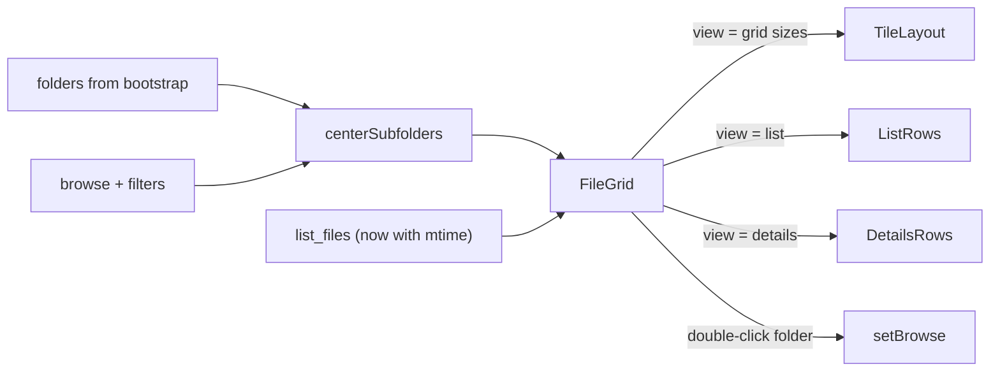

# List / Details views and sub-folders in the center grid

## Decisions (confirmed)
- One toggle in the footer: `Medium | Large | Extra large | List | Details`, persisted in the existing `gridSize` setting (key kept for `settings.json` compatibility). The View menu gets matching `List` and `Details` check items so menu and footer stay in sync.
- List: one vertical column of `name.ext` rows. Details columns, in order: Name (`name.ext`), Size, Date modified, Date added, Creator.
- Date modified = filesystem `mtime` already stored in the DB (seconds since epoch, refreshed on rescan), now sent to the UI. Date added stays `importedAt`.
- The Sort dropdown and the Details column headers control the same sort. Headers exist only in Details; the dropdown works in every view. Sort stays session-only, starting at name ascending, which is today's default.
- Sub-folders: shown before files, sorted by name, in grid, list, and details. Hidden whenever a search, creator, tag, or type filter is active, in either search scope. Double-click opens; single-click does nothing; folders are not selectable, draggable, or right-clickable.

## Data flow

## Backend (Rust)
- [src-tauri/src/db/mod.rs](src-tauri/src/db/mod.rs): add `pub mtime: i64` to `FileRow`.
- [src-tauri/src/db/rows.rs](src-tauri/src/db/rows.rs): add `mtime` to `FileSeed`.
- [src-tauri/src/db/listing.rs](src-tauri/src/db/listing.rs): add `f.mtime` / `mtime` to both SELECTs (`query_files`, `missing_files`), read it into `FileSeed`, copy it in `hydrate_with_tags`.
- [src-tauri/src/commands/settings.rs](src-tauri/src/commands/settings.rs): widen the `set_grid_size` check to `"medium" | "large" | "extraLarge" | "list" | "details"`.

## Frontend types and settings
- [src/types.ts](src/types.ts): `export type ViewMode = GridSize | "list" | "details";`, `Settings.gridSize: ViewMode`, `FileRow.mtime: number`.
- [src/hooks/libraryTypes.ts](src/hooks/libraryTypes.ts) and the `setGrid` implementation in [src/hooks/useSessionEffects.ts](src/hooks/useSessionEffects.ts): `setGrid(size: ViewMode)`. [src/hooks/useLibrary.ts](src/hooks/useLibrary.ts) `gridItems` typed `Record<ViewMode, ...>`.
- A displayed file label is `` `${file.sortName}.${file.ext}` ``. `sortName` is the stem with underscores turned into spaces, and `ext` is stored separately, so neither `sortName` nor `originalName` alone is the label. Folder rows use `folder.name`.
- [src/components/MenuBar.tsx](src/components/MenuBar.tsx): add `List` and `Details` `CheckMenuItem`s after Extra large; include them in the checked-sync effect.

## Sub-folder selection
- [src/lib/tagFilter.ts](src/lib/tagFilter.ts): pull the "is a filter active" check into `browseIsFiltered({ query, creator, selectedTagCount, selectedTypeCount })` and use it from both `libraryListScope` and `centerSubfolders`. (`filtersActive` in [src/lib/clearFilters.ts](src/lib/clearFilters.ts) already means something else.)
- `centerSubfolders({ folders, browse, ...filterInputs })` returns `[]` when `browseIsFiltered` is true. It does **not** check `libraryListScope(...).folder === "all"`: filtering in Current folder returns `"subtree"`, and folders must still be hidden. Otherwise it returns the folders whose `parentId` matches the browse target (`null` at the library root), sorted with `localeCompare(..., { numeric: true, sensitivity: "base" })`.

## FileGrid
[src/components/FileGrid.tsx](src/components/FileGrid.tsx)
- Props: rename `gridSize` to `view: ViewMode`; add `folders: FolderRow[]` and `onOpenFolder: (id: number) => void`.
- Build one item list: folders first, then files. Virtualization, marquee hit-testing and the empty-state check use the combined count, so an empty folder that has sub-folders no longer shows the empty message.
- Grid modes only: existing `visibleGridWindow` / `marqueeHitIndices`, and only after narrowing `view` to `GridSize`. `TILE_PX` has no `list` or `details` entry.
- List and Details: one column, no row gap. [src/lib/gridWindow.ts](src/lib/gridWindow.ts) exports `ROW_PX = 32` (the folder badge is 28px tall, so 24px would clip it) and `DETAILS_HEADER_PX`. `visibleRowWindow` and `rowHitIndices` use that stride. Details rows and marquee hits are offset by the header height. CSS sets the row height from the same `32px` value.
- Switching `view` resets the grid scroller's `scrollTop` to 0. A tile-sized scroll offset is meaningless in a 32px row list.
- Marquee hits map index to item and keep only file ids. The `pointerdown` handler also ignores `[data-folder-id]`. Otherwise pointer capture would redirect the folder's click and double-click to the scroller.
- File rows and tiles keep `data-file-id` and the existing click, double-click and context-menu handlers, so selection, drag-out and Delete keep working.
- Folder items use `data-folder-id`, and `onDoubleClick` calls `onOpenFolder(folder.id)`.
- Small presentational pieces (`FolderTile`, `ListRow`, `DetailsRow`, `DetailsHeader`) go in a new sibling [src/components/FileGridRows.tsx](src/components/FileGridRows.tsx) so `FileGrid.tsx` doesn't grow much further.
- Size is formatted with the existing `formatBytes` ([src/hooks/libraryTypes.ts](src/hooks/libraryTypes.ts)) and right-aligned. Both dates use `new Date(seconds * 1000).toLocaleString(undefined, { dateStyle: "short", timeStyle: "short" })`. Column widths: Name flexible, Size about 6rem, each date about 11rem, Creator about 8rem. Folder rows leave Size, both dates, and Creator blank.
- The Details header is a sticky row of buttons, one per column. The active column sets `aria-sort` to `ascending` or `descending` and shows an arrow. Clicking a header calls `onSort`. The marquee `pointerdown` handler ignores the header, so a header click does not start a selection drag.
- Styles: list/details rows, the sticky header, the folder badge (styled like the existing `.type-icon-txt` badge, with no emoji), and the selected-row highlight go in [src/styles/grid.css](src/styles/grid.css).
- [src/styles/inspector.css](src/styles/inspector.css): let `.status` wrap so the file count and the five view buttons can share a narrow window.

## App wiring
[src/App.tsx](src/App.tsx)
- Compute `subfolders = centerSubfolders(...)` and pass `view={settings.gridSize}`, `folders={subfolders}`, and `onOpenFolder={(id) => { setBrowse({ type: "folder", id }); setSelected([]); }}`. The sidebar already expands ancestors when `browseKey` changes (`Sidebar.tsx` lines 102-115).
- Footer `.view-toggle`: map over `["medium", "large", "extraLarge", "list", "details"]` with labels `Medium`, `Large`, `Extra large`, `List`, `Details`.

## Search scope radio (Current folder / Entire library)

### Decisions (confirmed)
- A radio group next to the search box: `Search in: ( ) Current folder ( ) Entire library`. It controls the scope of the search text **and** the Creator, file type and tag filters.
- Current folder means the current folder plus all its sub-folders, like Explorer. At the library root this is the same as Entire library.
- Defaults to Entire library (today's behavior). The choice is persisted in `settings.json`. Clear does not reset it, because it is a preference rather than a filter.
- The Creator dropdown lists only creators that have files in the current scope. The library-wide `creators` list still feeds autocomplete in the Inspector, Creator dialog and Import dialog, so it is left unchanged.
- The scope only applies while a search or filter is active. Plain browsing still shows only the files directly in the folder, and sub-folders stay hidden while filtering in either scope.

### Scope resolution (pure, in `libraryListScope`)
- Not filtering: `root` or `id` (unchanged).
- Filtering + Entire library: `all` (unchanged).
- Filtering + Current folder: `subtree` with `folderId` when browsing a folder, or `all` at the root.

### Backend (Rust)
- [src-tauri/src/db/rows.rs](src-tauri/src/db/rows.rs): add `FolderFilter::Subtree(i64)`.
- [src-tauri/src/db/listing.rs](src-tauri/src/db/listing.rs) `push_folder_scope`: add a `Subtree` arm reusing the recursive CTE already used by `file_ids_for_creator_scope` in [src-tauri/src/db/tags.rs](src-tauri/src/db/tags.rs) (around line 104):
  `AND f.folder_id IN (WITH RECURSIVE sub(id) AS (SELECT ? UNION ALL SELECT fo.id FROM folders fo JOIN sub ON fo.parent_id = sub.id) SELECT id FROM sub)`.
  This covers `query_files` and `type_counts`.
- [src-tauri/src/db/tags.rs](src-tauri/src/db/tags.rs) `tag_counts`: replace its inline folder `match` with `push_folder_scope`, made `pub(super)`. Call it in the same place, directly after the `LEFT JOIN ... ON` and before `GROUP BY`. Those `AND` fragments are part of the join condition today (there is no `WHERE`), which is what keeps zero-count tags in the list. Do not insert a `WHERE` ahead of the call.
- [src-tauri/src/commands/files.rs](src-tauri/src/commands/files.rs) `folder_filter`: accept `"subtree"` (requires `folder_id`).
- `list_creators`: accept optional `folder` / `folder_id` args (missing means `all`, so existing callers are unchanged). `AppDb::list_creators` takes a `FolderFilter` and uses `push_folder_scope`.
- [src-tauri/src/settings.rs](src-tauri/src/settings.rs): `#[serde(default = "default_search_scope")] pub search_scope: String` (`"library"`). New `set_search_scope` command in [src-tauri/src/commands/settings.rs](src-tauri/src/commands/settings.rs), validated to `"library" | "folder"` and registered in [src-tauri/src/lib.rs](src-tauri/src/lib.rs).

### Frontend
- [src/types.ts](src/types.ts): `export type SearchScope = "library" | "folder";` and `Settings.searchScope: SearchScope`.
- [src/api.ts](src/api.ts): `setSearchScope(scope)`, `listCreators(scope?: { folder: string; folderId: number | null })`, and `"subtree"` allowed in `folder`.
- [src/lib/tagFilter.ts](src/lib/tagFilter.ts): `libraryListScope` gains a `scope: SearchScope` input and can return `"subtree"`. `libraryRefreshKey` includes `scope`. `centerSubfolders` keeps using `browseIsFiltered`, so a Current-folder search still hides sub-folders.
- [src/hooks/useLibrary.ts](src/hooks/useLibrary.ts): keep `searchScope` on `settings`, updated the same way as `gridSize` (optimistic settings update, then `api.setSearchScope`). No second state copy. `refreshLists` passes `settings.searchScope` into `libraryListScope`, and `searchScope` is part of that callback's dependency list.
- Creator dropdown options follow the radio, including while nothing is being filtered. They do **not** follow `libraryListScope`, which stays `root`/`id` until a filter is active, and they are not narrowed by the selected creator, tags, types, or query (that would collapse the dropdown to the current creator).
  - Entire library, and Current folder while browsing the library root: reuse the existing library-wide `api.listCreators()` result. No second request.
  - Current folder while browsing a folder: `api.listCreators({ folder: "subtree", folderId })`.
- [src/hooks/useSessionEffects.ts](src/hooks/useSessionEffects.ts): add `searchScope` to the debounced refresh dependencies.
- [src/components/LibrarySearch.tsx](src/components/LibrarySearch.tsx): new props `scope` / `onScope`. The radio group (`role="radiogroup"`, `aria-label="Search scope"`, two native `<input type="radio">` with labels) sits in `.toolbar-search-row` after the search input and Clear button. Styles go in [src/styles/workspace.css](src/styles/workspace.css).
- [src/App.tsx](src/App.tsx): pass `scope` / `onScope`. The Creator `<select>` maps over `creatorOptions`. If the selected creator is not in the scoped list, it is kept as an option so the select doesn't go blank.

## Sort shared by the dropdown and Details headers

One session value, `{ field, direction }`, drives `list_files` in every view. Fields: `name`, `size`, `modified`, `date` (date added), `creator`.

- Clicking a header for a different field selects it and uses its default direction. Clicking the active header flips `asc` and `desc`.
- Choosing a field in the dropdown selects it and uses that same default direction. It does not flip. Picking the field that is already selected does not fire `onChange`, so the header's direction stays.
- Defaults: `name` and `creator` start ascending. `size`, `modified`, and `date` start descending (largest or newest first). `date` descending matches the current Date added sort.
- A pure `nextSort(current, field)` in [src/lib/tagFilter.ts](src/lib/tagFilter.ts) implements the header rule. The dropdown calls the default-direction helper directly.
- Dropdown labels, in column order: Sort name, Size, Date modified, Date added, Creator. `libraryRefreshKey` and `refreshLists` include both field and direction.
- [src-tauri/src/db/listing.rs](src-tauri/src/db/listing.rs): `query_files` takes a direction and matches it to `ASC` or `DESC` (unknown direction falls back to the field default). Unknown field falls back to name. Do not concatenate the request string into SQL. Each order is the chosen column, then `f.sort_name COLLATE NOCASE ASC` as a tie-break. Name sort is only `f.sort_name`.
- [src-tauri/src/commands/files.rs](src-tauri/src/commands/files.rs) and [src/api.ts](src/api.ts) `listFiles`: add `direction`.
- Sub-folders stay ahead of the files, sorted by name, for every field and direction.

## Known tradeoff
- Folder rows do not take part in the file sort. They stay in name order above the files when the files are sorted by size, date, or creator.

## Verification
- `npm run test:unit` (Vitest) passes, including new tests:
  - `gridWindow.test.ts`: `visibleRowWindow`, `rowHitIndices`.
  - `tagFilter.test.ts`: `centerSubfolders` covers root children, nested children, name order, and an empty result while filtering under **both** scopes (a Current-folder filter returns `"subtree"`, not `"all"`). Update the existing `libraryListScope` cases to pass `scope: "library"` so they still expect `"all"`.
  - `FileGrid.test.tsx`: List shows `pic.png` from `sortName` `pic` plus `ext` `png`. Details shows Name, Size, Date modified, Date added, and Creator. The active header exposes `aria-sort`. Clicking it calls `onSort`. Clicking a header does not change the file selection. Folders render before files. Double-clicking a folder calls `onOpenFolder` and not `onOpen`. Clicking a folder does not change the selection. Add `mtime` to every `FileRow` fixture (`FileGrid.test.tsx`, `Viewer.test.tsx`, `Inspector.test.tsx`, `FileContextMenu.test.tsx`).
  - `tagFilter.test.ts`: `nextSort` flips direction on the active field and applies the default direction when the field changes.
  - `toolbarLayout.test.tsx`: the search row's child order becomes input, Clear, then the radio group. Update the `children[1]` assertion.
  - `tagFilter.test.ts`: `libraryListScope` covers both scopes in three cases (not filtering, filtering at the root, filtering in a folder), and `libraryRefreshKey` changes when the scope changes.
  - `LibrarySearch.test.tsx`: the radio reflects `scope` and clicking the other option calls `onScope`.
- `cargo test` in `src-tauri` passes, with new tests showing that:
  - the listing returns `mtime`;
  - size descending, modified ascending, and date-added descending order the seeded files, with `sort_name` breaking ties;
  - `FolderFilter::Subtree` includes nested-folder files and excludes sibling folders, in `query_files`, `tag_counts` and `type_counts`;
  - the scoped `list_creators` only returns creators within the subtree;
  - settings without `searchScope` load as `"library"`.
- `npx tsc --noEmit` is clean.
- Manual run:
  - Switch between all five view modes; the setting persists after restart.
  - Double-click a sub-folder in each mode, and confirm folders disappear while searching.
  - Confirm marquee and Delete still work in List and Details.
  - Search in a nested folder under both scopes, and confirm tag/type counts and the Creator list follow the scope.
  - In Details, click a column header and confirm the dropdown matches. Change the dropdown and confirm the header highlight matches. Click the active header and confirm the order reverses.
  - The scope choice persists after restart.
